# Running Flink on your laptop

## Introduction

We want to exemplify this quickstart guide: https://developer.confluent.io/quickstart/flink-on-confluent-cloud/ in a local environment. The goal is to run a Flink job that reads data from a Kafka topic and writes it to another Kafka topic. We will be using Docker to run Kafka and Flink locally.

Here is the diagram that illustrates the architecture of the project:

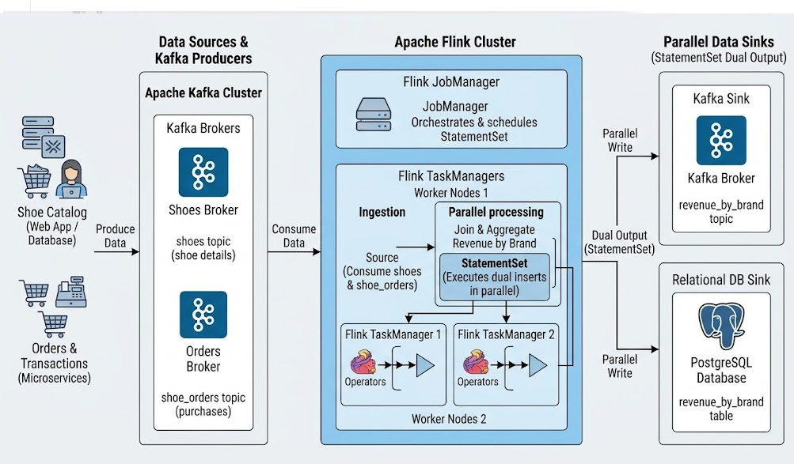

## Project creation

I have created a simple Flink project that reads data from a Kafka topic and writes it to another Kafka topic. The project is built using Maven and can be run locally using Docker.

We will be following the quickstart guide for running Flink on Confluent Cloud: https://developer.confluent.io/quickstart/flink-on-confluent-cloud/. But instead of using Confluent Cloud, we will be running Kafka and Flink locally using Docker.

```shell
user@DESKTOP-SCNMK3I UCRT64 ~/Documents/FlinkProjects
Tue Nov 03 14:38:56
$ mvn archetype:generate \
  -DarchetypeGroupId=org.apache.flink \
  -DarchetypeArtifactId=flink-quickstart-java \
  -DarchetypeVersion=1.18.1 \
  -DgroupId=com.example.flink \
  -DartifactId=FlinkKafkaApp \
  -Dversion=1.0-SNAPSHOT \
  -Dpackage=com.example.flink \
  -DinteractiveMode=false
[INFO] Scanning for projects...
[INFO]
[INFO] ------------------< org.apache.maven:standalone-pom >-------------------
[INFO] Building Maven Stub Project (No POM) 1
[INFO] --------------------------------[ pom ]---------------------------------
[INFO]
[INFO] >>> archetype:3.4.1:generate (default-cli) > generate-sources @ standalone-pom >>>
[INFO]
[INFO] <<< archetype:3.4.1:generate (default-cli) < generate-sources @ standalone-pom <<<
[INFO]
[INFO]
[INFO] --- archetype:3.4.1:generate (default-cli) @ standalone-pom ---
[INFO] Generating project in Batch mode
[INFO] Archetype repository not defined. Using the one from [org.apache.flink:flink-quickstart-java:2.3.0] found in catalog remote
[INFO] ----------------------------------------------------------------------------
[INFO] Using following parameters for creating project from Archetype: flink-quickstart-java:1.18.1
[INFO] ----------------------------------------------------------------------------
[INFO] Parameter: groupId, Value: com.example.flink
[INFO] Parameter: artifactId, Value: FlinkKafkaApp
[INFO] Parameter: version, Value: 1.0-SNAPSHOT
[INFO] Parameter: package, Value: com.example.flink
[INFO] Parameter: packageInPathFormat, Value: com/example/flink
[INFO] Parameter: package, Value: com.example.flink
[INFO] Parameter: groupId, Value: com.example.flink
[INFO] Parameter: artifactId, Value: FlinkKafkaApp
[INFO] Parameter: version, Value: 1.0-SNAPSHOT
[WARNING] CP Don't override file C:\Users\user\Documents\FlinkProjects\FlinkKafkaApp\src\main\resources
[INFO] Project created from Archetype in dir: C:\Users\user\Documents\FlinkProjects\FlinkKafkaApp
[INFO] ------------------------------------------------------------------------
[INFO] BUILD SUCCESS
[INFO] ------------------------------------------------------------------------
[INFO] Total time:  2.182 s
[INFO] Finished at: 2026-11-03T14:39:54+01:00
[INFO] ------------------------------------------------------------------------
```

The project structure will look like this:

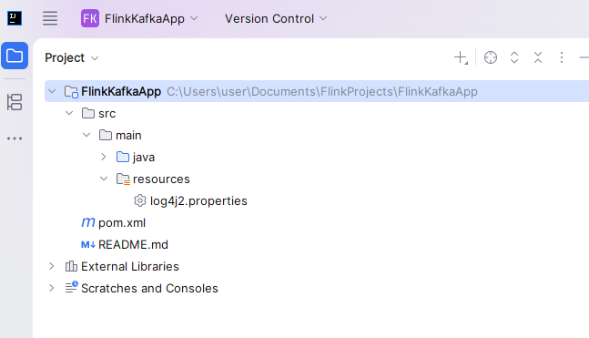

## Running Flink and Kafka using Docker

Use the provided `docker-compose.yml` file to start the Flink and Kafka clusters. The `docker-compose.yml` file is located in the `docker` directory of the project.

```shell

user@DESKTOP-SCNMK3I UCRT64 ~/Documents/FlinkProjects/FlinkKafkaApp/docker
Tue Nov 03 14:45:24
$ docker compose up -d
[+] up 34/34
 [+] up 5/5
 ✔ Container zookeeper   Started          0.2s
 ✔ Container postgres    Started          0.7s
 ✔ Container jobmanager  Started          1.0s
 ✔ Container broker      Started          0.3s
 ✔ Container taskmanager Started      
```

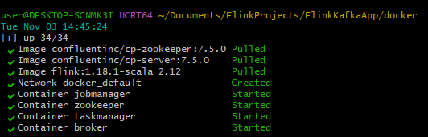


```shell
user@DESKTOP-SCNMK3I UCRT64 ~/Documents/FlinkProjects/FlinkKafkaApp/docker
Tue Nov 03 14:49:19
$ docker ps
CONTAINER ID   IMAGE                             COMMAND                  CREATED          STATUS         PORTS                                                                                      NAMES
7efe933bce74   flink:1.18.1-scala_2.12           "/docker-entrypoint.…"   25 seconds ago   Up 3 seconds   6123/tcp, 8081/tcp                                                                         taskmanager
0868a3e7735b   flink:1.18.1-scala_2.12           "/docker-entrypoint.…"   25 seconds ago   Up 4 seconds   0.0.0.0:8081->8081/tcp, [::]:8081->8081/tcp                                                jobmanager
6cf57b4ccd1b   postgres:15-alpine                "docker-entrypoint.s…"   36 minutes ago   Up 4 seconds   0.0.0.0:5432->5432/tcp, [::]:5432->5432/tcp                                                postgres
101be6339097   confluentinc/cp-server:7.5.0      "/etc/confluent/dock…"   2 days ago       Up 4 seconds   0.0.0.0:9092->9092/tcp, [::]:9092->9092/tcp, 0.0.0.0:9101->9101/tcp, [::]:9101->9101/tcp   broker
af61e3e7eeac   confluentinc/cp-zookeeper:7.5.0   "/etc/confluent/dock…"   2 days ago       Up 4 seconds   0.0.0.0:2181->2181/tcp, [::]:2181->2181/tcp                                                zookeeper
```

## Interacting with Flink SQL Client

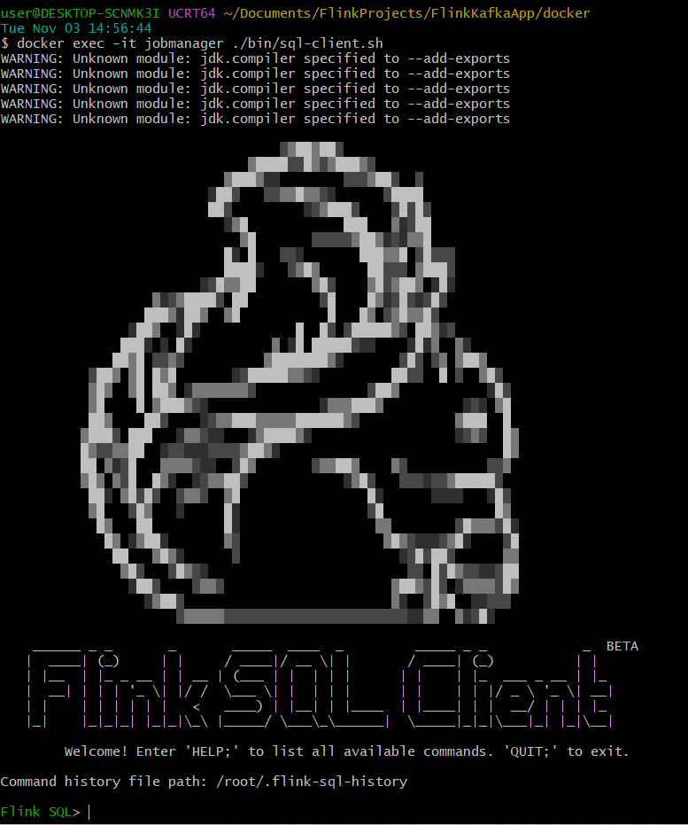

```shell
Flink SQL> CREATE TABLE quickstart (
>    message STRING
>  ) WITH (
>    'connector' = 'kafka',
>    'topic' = 'quickstart',
>    'properties.bootstrap.servers' = 'broker:29092',
>    'scan.startup.mode' = 'earliest-offset',
>    'format' = 'raw'
>  );
[INFO] Execute statement succeed.

Flink SQL> show tables;
+-------------+
|  table name |
+-------------+
|  quickstart |
+-------------+
1 rows in set

Flink SQL> INSERT INTO quickstart VALUES ('hello world');
[INFO] Submitting SQL update statement to the cluster...
[INFO] SQL update statement has been successfully submitted to the cluster:
Job ID: 90172f8fb94d1eaf7b7d4483c9f97ae5

Flink SQL> select * from quickstart;
                        message
-------------------------------                        
                    hello world
```

## Interact with Kafka topics

Let's insert some sample shoe messages into the `shoes` topic:

```shell
docker exec -it broker kafka-console-producer --topic shoes --bootstrap-server localhost:9092

{"id": "1db091e5-c516-4286-84a2-8d687d6c0331", "brand": "Williamson Group", "name": "Impreza Pro 634", "sale_price": 7995.0, "rowtime": "2026-11-03 15:00:00.000"}
{"id": "2ef832f6-d727-5397-95b3-9e788e7d8f42", "brand": "Nike", "name": "Air Max 270", "sale_price": 150.0, "rowtime": "2026-11-03 15:00:00.000"}
{"id": "3fc943a7-e838-6408-a6c4-0f899f8e9g53", "brand": "Adidas", "name": "Ultraboost Light", "sale_price": 190.0, "rowtime": "2026-11-03 15:00:00.000"}
{"id": "4ad054b8-f949-7519-b7d5-1f900a9f0h64", "brand": "Puma", "name": "RS-X Efekt", "sale_price": 110.0, "rowtime": "2026-11-03 15:00:00.000"}
{"id": "5be165c9-a05a-8620-c8e6-2g011b0a1i75", "brand": "New Balance", "name": "Fresh Foam 1080", "sale_price": 165.0, "rowtime": "2026-11-03 15:00:00.000"}
{"id": "6cf276da-b16b-9731-d9f7-3h122c1b2j86", "brand": "Asics", "name": "Gel-Kayano 30", "sale_price": 160.0, "rowtime": "2026-11-03 15:00:00.000"}
{"id": "7dc387eb-c27c-0842-e0g8-4i233d2c3k97", "brand": "Under Armour", "name": "Flow Velociti Wind 2", "sale_price": 140.0, "rowtime": "2026-11-03 15:00:00.000"}
{"id": "8ed498fc-d38d-1953-f1h9-5j344e3d4l08", "brand": "Reebok", "name": "Nano X3", "sale_price": 140.0, "rowtime": "2026-11-03 15:00:00.000"}
{"id": "9fe5a9ad-e49e-2064-02i0-6k455f4e5m19", "brand": "Saucony", "name": "Endorphin Speed 3", "sale_price": 170.0, "rowtime": "2026-11-03 15:00:00.000"}
{"id": "0af6bafe-f50f-3175-13j1-7l566g5f6n20", "brand": "Brooks", "name": "Ghost 15", "sale_price": 140.0, "rowtime": "2026-11-03 15:00:00.000"}
{"id": "1bg7cb0f-0610-4286-24k2-8m677h6g7o31", "brand": "Hoka", "name": "Clifton 9", "sale_price": 145.0, "rowtime": "2026-11-03 15:00:00.000"}
{"id": "2ch8dc1a-1721-5397-35l3-9n788i7h8p42", "brand": "Mizuno", "name": "Wave Rider 27", "sale_price": 140.0, "rowtime": "2026-11-03 15:00:00.000"}
{"id": "3di9ed2b-2832-6408-46m4-0o899j8i9q53", "brand": "Salomon", "name": "Speedcross 6", "sale_price": 150.0, "rowtime": "2026-11-03 15:00:00.000"}
{"id": "4ej0fe3c-3943-7519-57n5-1p900k9j0r64", "brand": "Converse", "name": "Chuck Taylor All Star", "sale_price": 65.0, "rowtime": "2026-11-03 15:00:00.000"}
{"id": "5fk1gf4d-4054-8620-68o6-2q011l0k1s75", "brand": "Vans", "name": "Old Skool", "sale_price": 75.0, "rowtime": "2026-11-03 15:00:00.000"}
{"id": "6gl2hg5e-5165-9731-79p7-3r122m1l2t86", "brand": "Jordan", "name": "Air Jordan 1 Retro", "sale_price": 180.0, "rowtime": "2026-11-03 15:00:00.000"}
{"id": "7hm3ih6f-6276-0842-80q8-4s233n2m3u97", "brand": "On", "name": "Cloudmonster", "sale_price": 170.0, "rowtime": "2026-11-03 15:00:00.000"}
{"id": "8in4ji7g-7387-1953-91r9-5t344o3n4v08", "brand": "Skechers", "name": "Go Walk 6", "sale_price": 90.0, "rowtime": "2026-11-03 15:00:00.000"}
{"id": "9jo5kj8h-8498-2064-02s0-6u455p4o5w19", "brand": "Altra", "name": "Lone Peak 7", "sale_price": 150.0, "rowtime": "2026-11-03 15:00:00.000"}
{"id": "0kp6lk9i-9509-3175-13t1-7v566q5p6x20", "brand": "Fila", "name": "Disruptor II", "sale_price": 75.0, "rowtime": "2026-11-03 15:00:00.000"}
```

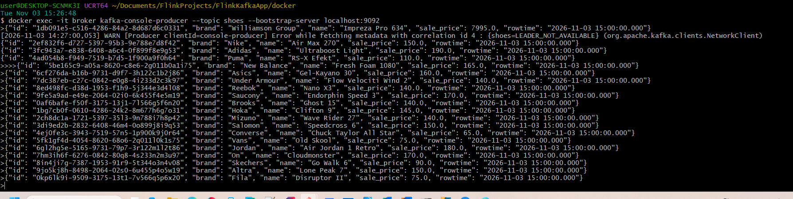


Let's insert some sample shoe order messages into the `shoe_orders` topic:

```shell
user@DESKTOP-SCNMK3I UCRT64 ~/Documents/FlinkProjects/FlinkKafkaApp/docker
Tue Nov 03 15:28:07
$ docker exec -it broker kafka-console-producer --topic shoe_orders --bootstrap-server localhost:9092
>{"order_id": 101, "product_id": "1db091e5-c516-4286-84a2-8d687d6c0331", "quantity": 2, "order_time": "2026-11-03 15:01:00.000"}
>{"order_id": 102, "product_id": "2ef832f6-d727-5397-95b3-9e788e7d8f42", "quantity": 1, "order_time": "2026-11-03 15:02:00.000"}
>{"order_id": 103, "product_id": "3fc943a7-e838-6408-a6c4-0f899f8e9g53", "quantity": 3, "order_time": "2026-11-03 15:03:00.000"}
>{"order_id": 104, "product_id": "4ad054b8-f949-7519-b7d5-1f900a9f0h64", "quantity": 1, "order_time": "2026-11-03 15:04:00.000"}
>{"order_id": 105, "product_id": "5be165c9-a05a-8620-c8e6-2g011b0a1i75", "quantity": 2, "order_time": "2026-11-03 15:05:00.000"}
>{"order_id": 106, "product_id": "6cf276da-b16b-9731-d9f7-3h122c1b2j86", "quantity": 4, "order_time": "2026-11-03 15:06:00.000"}
>{"order_id": 107, "product_id": "7dc387eb-c27c-0842-e0g8-4i233d2c3k97", "quantity": 1, "order_time": "2026-11-03 15:07:00.000"}
>{"order_id": 108, "product_id": "8ed498fc-d38d-1953-f1h9-5j344e3d4l08", "quantity": 2, "order_time": "2026-11-03 15:08:00.000"}
>{"order_id": 109, "product_id": "9fe5a9ad-e49e-2064-02i0-6k455f4e5m19", "quantity": 1, "order_time": "2026-11-03 15:09:00.000"}
>{"order_id": 110, "product_id": "0af6bafe-f50f-3175-13j1-7l566g5f6n20", "quantity": 5, "order_time": "2026-11-03 15:10:00.000"}
>{"order_id": 111, "product_id": "1bg7cb0f-0610-4286-24k2-8m677h6g7o31", "quantity": 2, "order_time": "2026-11-03 15:11:00.000"}
>{"order_id": 112, "product_id": "2ch8dc1a-1721-5397-35l3-9n788i7h8p42", "quantity": 3, "order_time": "2026-11-03 15:12:00.000"}
>{"order_id": 113, "product_id": "3di9ed2b-2832-6408-46m4-0o899j8i9q53", "quantity": 1, "order_time": "2026-11-03 15:13:00.000"}
>{"order_id": 114, "product_id": "4ej0fe3c-3943-7519-57n5-1p900k9j0r64", "quantity": 4, "order_time": "2026-11-03 15:14:00.000"}
>{"order_id": 115, "product_id": "5fk1gf4d-4054-8620-68o6-2q011l0k1s75", "quantity": 2, "order_time": "2026-11-03 15:15:00.000"}
>{"order_id": 116, "product_id": "6gl2hg5e-5165-9731-79p7-3r122m1l2t86", "quantity": 1, "order_time": "2026-11-03 15:16:00.000"}
>{"order_id": 117, "product_id": "7hm3ih6f-6276-0842-80q8-4s233n2m3u97", "quantity": 3, "order_time": "2026-11-03 15:17:00.000"}
>{"order_id": 118, "product_id": "8in4ji7g-7387-1953-91r9-5t344o3n4v08", "quantity": 2, "order_time": "2026-11-03 15:18:00.000"}
>{"order_id": 119, "product_id": "9jo5kj8h-8498-2064-02s0-6u455p4o5w19", "quantity": 1, "order_time": "2026-11-03 15:19:00.000"}
>{"order_id": 120, "product_id": "0kp6lk9i-9509-3175-13t1-7v566q5p6x20", "quantity": 5, "order_time": "2026-11-03 15:20:00.000"}
>^C
```

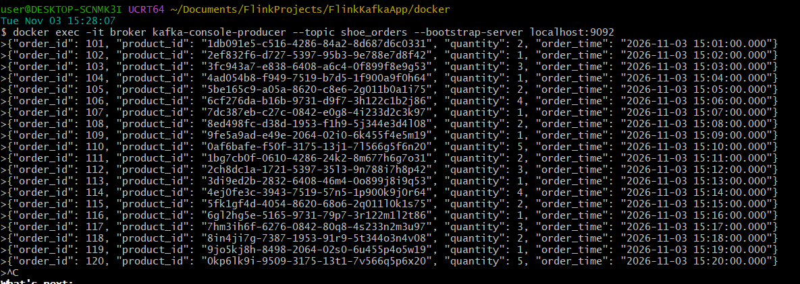


```shell
user@DESKTOP-SCNMK3I UCRT64 ~/Documents/FlinkProjects/FlinkKafkaApp/docker
Tue Nov 03 15:40:24
$ docker exec -it broker kafka-console-consumer --topic shoes --bootstrap-server localhost:9092 --from-beginning
{"id": "1db091e5-c516-4286-84a2-8d687d6c0331", "brand": "Williamson Group", "name": "Impreza Pro 634", "sale_price": 7995.0, "rowtime": "2026-11-03 15:00:00.000"}
{"id": "2ef832f6-d727-5397-95b3-9e788e7d8f42", "brand": "Nike", "name": "Air Max 270", "sale_price": 150.0, "rowtime": "2026-11-03 15:00:00.000"}
{"id": "3fc943a7-e838-6408-a6c4-0f899f8e9g53", "brand": "Adidas", "name": "Ultraboost Light", "sale_price": 190.0, "rowtime": "2026-11-03 15:00:00.000"}
{"id": "4ad054b8-f949-7519-b7d5-1f900a9f0h64", "brand": "Puma", "name": "RS-X Efekt", "sale_price": 110.0, "rowtime": "2026-11-03 15:00:00.000"}
{"id": "5be165c9-a05a-8620-c8e6-2g011b0a1i75", "brand": "New Balance", "name": "Fresh Foam 1080", "sale_price": 165.0, "rowtime": "2026-11-03 15:00:00.000"}
{"id": "6cf276da-b16b-9731-d9f7-3h122c1b2j86", "brand": "Asics", "name": "Gel-Kayano 30", "sale_price": 160.0, "rowtime": "2026-11-03 15:00:00.000"}
{"id": "7dc387eb-c27c-0842-e0g8-4i233d2c3k97", "brand": "Under Armour", "name": "Flow Velociti Wind 2", "sale_price": 140.0, "rowtime": "2026-11-03 15:00:00.000"}
{"id": "8ed498fc-d38d-1953-f1h9-5j344e3d4l08", "brand": "Reebok", "name": "Nano X3", "sale_price": 140.0, "rowtime": "2026-11-03 15:00:00.000"}
{"id": "9fe5a9ad-e49e-2064-02i0-6k455f4e5m19", "brand": "Saucony", "name": "Endorphin Speed 3", "sale_price": 170.0, "rowtime": "2026-11-03 15:00:00.000"}
{"id": "0af6bafe-f50f-3175-13j1-7l566g5f6n20", "brand": "Brooks", "name": "Ghost 15", "sale_price": 140.0, "rowtime": "2026-11-03 15:00:00.000"}
{"id": "1bg7cb0f-0610-4286-24k2-8m677h6g7o31", "brand": "Hoka", "name": "Clifton 9", "sale_price": 145.0, "rowtime": "2026-11-03 15:00:00.000"}
{"id": "2ch8dc1a-1721-5397-35l3-9n788i7h8p42", "brand": "Mizuno", "name": "Wave Rider 27", "sale_price": 140.0, "rowtime": "2026-11-03 15:00:00.000"}
{"id": "3di9ed2b-2832-6408-46m4-0o899j8i9q53", "brand": "Salomon", "name": "Speedcross 6", "sale_price": 150.0, "rowtime": "2026-11-03 15:00:00.000"}
{"id": "4ej0fe3c-3943-7519-57n5-1p900k9j0r64", "brand": "Converse", "name": "Chuck Taylor All Star", "sale_price": 65.0, "rowtime": "2026-11-03 15:00:00.000"}
{"id": "5fk1gf4d-4054-8620-68o6-2q011l0k1s75", "brand": "Vans", "name": "Old Skool", "sale_price": 75.0, "rowtime": "2026-11-03 15:00:00.000"}
{"id": "6gl2hg5e-5165-9731-79p7-3r122m1l2t86", "brand": "Jordan", "name": "Air Jordan 1 Retro", "sale_price": 180.0, "rowtime": "2026-11-03 15:00:00.000"}
{"id": "7hm3ih6f-6276-0842-80q8-4s233n2m3u97", "brand": "On", "name": "Cloudmonster", "sale_price": 170.0, "rowtime": "2026-11-03 15:00:00.000"}
{"id": "8in4ji7g-7387-1953-91r9-5t344o3n4v08", "brand": "Skechers", "name": "Go Walk 6", "sale_price": 90.0, "rowtime": "2026-11-03 15:00:00.000"}
{"id": "9jo5kj8h-8498-2064-02s0-6u455p4o5w19", "brand": "Altra", "name": "Lone Peak 7", "sale_price": 150.0, "rowtime": "2026-11-03 15:00:00.000"}
{"id": "0kp6lk9i-9509-3175-13t1-7v566q5p6x20", "brand": "Fila", "name": "Disruptor II", "sale_price": 75.0, "rowtime": "2026-11-03 15:00:00.000"}
^CProcessed a total of 20 messages


user@DESKTOP-SCNMK3I UCRT64 ~/Documents/FlinkProjects/FlinkKafkaApp/docker
Tue Nov 03 15:41:06
$ docker exec -it broker kafka-console-consumer --topic shoe_orders --bootstrap-server localhost:9092 --from-beginning
{"order_id": 101, "product_id": "1db091e5-c516-4286-84a2-8d687d6c0331", "quantity": 2, "order_time": "2026-11-03 15:01:00.000"}
{"order_id": 102, "product_id": "2ef832f6-d727-5397-95b3-9e788e7d8f42", "quantity": 1, "order_time": "2026-11-03 15:02:00.000"}
{"order_id": 103, "product_id": "3fc943a7-e838-6408-a6c4-0f899f8e9g53", "quantity": 3, "order_time": "2026-11-03 15:03:00.000"}
{"order_id": 104, "product_id": "4ad054b8-f949-7519-b7d5-1f900a9f0h64", "quantity": 1, "order_time": "2026-11-03 15:04:00.000"}
{"order_id": 105, "product_id": "5be165c9-a05a-8620-c8e6-2g011b0a1i75", "quantity": 2, "order_time": "2026-11-03 15:05:00.000"}
{"order_id": 106, "product_id": "6cf276da-b16b-9731-d9f7-3h122c1b2j86", "quantity": 4, "order_time": "2026-11-03 15:06:00.000"}
{"order_id": 107, "product_id": "7dc387eb-c27c-0842-e0g8-4i233d2c3k97", "quantity": 1, "order_time": "2026-11-03 15:07:00.000"}
{"order_id": 108, "product_id": "8ed498fc-d38d-1953-f1h9-5j344e3d4l08", "quantity": 2, "order_time": "2026-11-03 15:08:00.000"}
{"order_id": 109, "product_id": "9fe5a9ad-e49e-2064-02i0-6k455f4e5m19", "quantity": 1, "order_time": "2026-11-03 15:09:00.000"}
{"order_id": 110, "product_id": "0af6bafe-f50f-3175-13j1-7l566g5f6n20", "quantity": 5, "order_time": "2026-11-03 15:10:00.000"}
{"order_id": 111, "product_id": "1bg7cb0f-0610-4286-24k2-8m677h6g7o31", "quantity": 2, "order_time": "2026-11-03 15:11:00.000"}
{"order_id": 112, "product_id": "2ch8dc1a-1721-5397-35l3-9n788i7h8p42", "quantity": 3, "order_time": "2026-11-03 15:12:00.000"}
{"order_id": 113, "product_id": "3di9ed2b-2832-6408-46m4-0o899j8i9q53", "quantity": 1, "order_time": "2026-11-03 15:13:00.000"}
{"order_id": 114, "product_id": "4ej0fe3c-3943-7519-57n5-1p900k9j0r64", "quantity": 4, "order_time": "2026-11-03 15:14:00.000"}
{"order_id": 115, "product_id": "5fk1gf4d-4054-8620-68o6-2q011l0k1s75", "quantity": 2, "order_time": "2026-11-03 15:15:00.000"}
{"order_id": 116, "product_id": "6gl2hg5e-5165-9731-79p7-3r122m1l2t86", "quantity": 1, "order_time": "2026-11-03 15:16:00.000"}
{"order_id": 117, "product_id": "7hm3ih6f-6276-0842-80q8-4s233n2m3u97", "quantity": 3, "order_time": "2026-11-03 15:17:00.000"}
{"order_id": 118, "product_id": "8in4ji7g-7387-1953-91r9-5t344o3n4v08", "quantity": 2, "order_time": "2026-11-03 15:18:00.000"}
{"order_id": 119, "product_id": "9jo5kj8h-8498-2064-02s0-6u455p4o5w19", "quantity": 1, "order_time": "2026-11-03 15:19:00.000"}
```

## Consuming Messages from Kafka Topics using Flink SQL

Let's consume the messages from the `shoes` and `shoe_orders` topics using Flink SQL:

```shell

user@DESKTOP-SCNMK3I UCRT64 ~/Documents/FlinkProjects/FlinkKafkaApp/docker
Tue Nov 03 15:42:18
$ docker exec -it jobmanager ./bin/sql-client.sh
WARNING: Unknown module: jdk.compiler specified to --add-exports
WARNING: Unknown module: jdk.compiler specified to --add-exports
WARNING: Unknown module: jdk.compiler specified to --add-exports
WARNING: Unknown module: jdk.compiler specified to --add-exports
WARNING: Unknown module: jdk.compiler specified to --add-exports

                                   ▒▓██▓██▒
                               ▓████▒▒█▓▒▓███▓▒
                            ▓███▓░░        ▒▒▒▓██▒  ▒
                          ░██▒   ▒▒▓▓█▓▓▒░      ▒████
                          ██▒         ░▒▓███▒    ▒█▒█▒
                            ░▓█            ███   ▓░▒██
                              ▓█       ▒▒▒▒▒▓██▓░▒░▓▓█
                            █░ █   ▒▒░       ███▓▓█ ▒█▒▒▒
                            ████░   ▒▓█▓      ██▒▒▒ ▓███▒
                         ░▒█▓▓██       ▓█▒    ▓█▒▓██▓ ░█░
                   ▓░▒▓████▒ ██         ▒█    █▓░▒█▒░▒█▒
                  ███▓░██▓  ▓█           █   █▓ ▒▓█▓▓█▒
                ░██▓  ░█░            █  █▒ ▒█████▓▒ ██▓░▒
               ███░ ░ █░          ▓ ░█ █████▒░░    ░█░▓  ▓░
              ██▓█ ▒▒▓▒          ▓███████▓░       ▒█▒ ▒▓ ▓██▓
           ▒██▓ ▓█ █▓█       ░▒█████▓▓▒░         ██▒▒  █ ▒  ▓█▒
           ▓█▓  ▓█ ██▓ ░▓▓▓▓▓▓▓▒              ▒██▓           ░█▒
           ▓█    █ ▓███▓▒░              ░▓▓▓███▓          ░▒░ ▓█
           ██▓    ██▒    ░▒▓▓███▓▓▓▓▓██████▓▒            ▓███  █
          ▓███▒ ███   ░▓▓▒░░   ░▓████▓░                  ░▒▓▒  █▓
          █▓▒▒▓▓██  ░▒▒░░░▒▒▒▒▓██▓░                            █▓
          ██ ▓░▒█   ▓▓▓▓▒░░  ▒█▓       ▒▓▓██▓    ▓▒          ▒▒▓
          ▓█▓ ▓▒█  █▓░  ░▒▓▓██▒            ░▓█▒   ▒▒▒░▒▒▓█████▒
           ██░ ▓█▒█▒  ▒▓▓▒  ▓█                █░      ░░░░   ░█▒
           ▓█   ▒█▓   ░     █░                ▒█              █▓
            █▓   ██         █░                 ▓▓        ▒█▓▓▓▒█░
             █▓ ░▓██░       ▓▒                  ▓█▓▒░░░▒▓█░    ▒█
              ██   ▓█▓░      ▒                    ░▒█▒██▒      ▓▓
               ▓█▒   ▒█▓▒░                         ▒▒ █▒█▓▒▒░░▒██
                ░██▒    ▒▓▓▒                     ▓██▓▒█▒ ░▓▓▓▓▒█▓
                  ░▓██▒                          ▓░  ▒█▓█  ░░▒▒▒
                      ▒▓▓▓▓▓▒▒▒▒▒▒▒▒▒▒▒▒▒▒▒▒▒▒▒▒▒▒▒░░▓▓  ▓░▒█░

    ______ _ _       _       _____  ____  _         _____ _ _            _  BETA
   |  ____| (_)     | |     / ____|/ __ \| |       / ____| (_)          | |
   | |__  | |_ _ __ | | __ | (___ | |  | | |      | |    | |_  ___ _ __ | |_
   |  __| | | | '_ \| |/ /  \___ \| |  | | |      | |    | | |/ _ \ '_ \| __|
   | |    | | | | | |   <   ____) | |__| | |____  | |____| | |  __/ | | | |_
   |_|    |_|_|_| |_|_|\_\ |_____/ \___\_\______|  \_____|_|_|\___|_| |_|\__|

        Welcome! Enter 'HELP;' to list all available commands. 'QUIT;' to exit.

Command history file path: /root/.flink-sql-history

Flink SQL> CREATE TABLE shoes (
  id STRING,
  brand STRING,
  name STRING,
  sale_price DOUBLE,
  rowtime TIMESTAMP(3),
  WATERMARK FOR rowtime AS rowtime - INTERVAL '5' SECOND
) WITH (
  'connector' = 'kafka',
  'topic' = 'shoes',
  'properties.bootstrap.servers' = 'broker:29092',
  'scan.startup.mode' = 'earliest-offset',
  'format' = 'json'
);
[INFO] Execute statement succeed.


Flink SQL> CREATE TABLE shoe_orders (
  order_id BIGINT,
  product_id STRING,
  quantity INT,
  order_time TIMESTAMP(3),
  WATERMARK FOR order_time AS order_time - INTERVAL '5' SECOND
) WITH (
  'connector' = 'kafka',
  'topic' = 'shoe_orders',
  'properties.bootstrap.servers' = 'broker:29092',
  'scan.startup.mode' = 'earliest-offset',
  'format' = 'json'
);
[INFO] Execute statement succeed.


Flink SQL> show tables;
+-------------+
|  table name |
+-------------+
|  quickstart |
| shoe_orders |
|       shoes |
+-------------+
3 rows in set

Flink SQL> DESCRIBE shoes;
+------------+------------------------+------+-----+--------+---------------------------------+
|       name |                   type | null | key | extras |                       watermark |
+------------+------------------------+------+-----+--------+---------------------------------+
|         id |                 STRING | TRUE |     |        |                                 |
|      brand |                 STRING | TRUE |     |        |                                 |
|       name |                 STRING | TRUE |     |        |                                 |
| sale_price |                 DOUBLE | TRUE |     |        |                                 |
|    rowtime | TIMESTAMP(3) *ROWTIME* | TRUE |     |        | `rowtime` - INTERVAL '5' SECOND |
+------------+------------------------+------+-----+--------+---------------------------------+
5 rows in set

Flink SQL> DESCRIBE shoe_orders;
+------------+------------------------+------+-----+--------+------------------------------------+
|       name |                   type | null | key | extras |                          watermark |
+------------+------------------------+------+-----+--------+------------------------------------+
|   order_id |                 BIGINT | TRUE |     |        |                                    |
| product_id |                 STRING | TRUE |     |        |                                    |
|   quantity |                    INT | TRUE |     |        |                                    |
| order_time | TIMESTAMP(3) *ROWTIME* | TRUE |     |        | `order_time` - INTERVAL '5' SECOND |
+------------+------------------------+------+-----+--------+------------------------------------+
4 rows in set


Flink SQL> select * from shoes;

                             id                 brand                        name       sale_price                                  rowtime
---------------------------------------------------------------------------------------------------                 -------------------------                             
 1db091e5-c516-4286-84a2-8d687~      Williamson Group             Impreza Pro 634           7995.0                  2026-11-03 15:00:00.000
 2ef832f6-d727-5397-95b3-9e788~                  Nike                 Air Max 270            150.0                  2026-11-03 15:00:00.000
 3fc943a7-e838-6408-a6c4-0f899~                Adidas            Ultraboost Light            190.0                  2026-11-03 15:00:00.000
 4ad054b8-f949-7519-b7d5-1f900~                  Puma                  RS-X Efekt            110.0                  2026-11-03 15:00:00.000
 5be165c9-a05a-8620-c8e6-2g011~           New Balance             Fresh Foam 1080            165.0                  2026-11-03 15:00:00.000
 6cf276da-b16b-9731-d9f7-3h122~                 Asics               Gel-Kayano 30            160.0                  2026-11-03 15:00:00.000
 7dc387eb-c27c-0842-e0g8-4i233~          Under Armour        Flow Velociti Wind 2            140.0                  2026-11-03 15:00:00.000
 8ed498fc-d38d-1953-f1h9-5j344~                Reebok                     Nano X3            140.0                  2026-11-03 15:00:00.000
 9fe5a9ad-e49e-2064-02i0-6k455~               Saucony           Endorphin Speed 3            170.0                  2026-11-03 15:00:00.000
 0af6bafe-f50f-3175-13j1-7l566~                Brooks                    Ghost 15            140.0                  2026-11-03 15:00:00.000
 1bg7cb0f-0610-4286-24k2-8m677~                  Hoka                   Clifton 9            145.0                  2026-11-03 15:00:00.000
 2ch8dc1a-1721-5397-35l3-9n788~                Mizuno               Wave Rider 27            140.0                  2026-11-03 15:00:00.000
 3di9ed2b-2832-6408-46m4-0o899~               Salomon                Speedcross 6            150.0                  2026-11-03 15:00:00.000
 4ej0fe3c-3943-7519-57n5-1p900~              Converse       Chuck Taylor All Star             65.0                  2026-11-03 15:00:00.000
 5fk1gf4d-4054-8620-68o6-2q011~                  Vans                   Old Skool             75.0                  2026-11-03 15:00:00.000
 6gl2hg5e-5165-9731-79p7-3r122~                Jordan          Air Jordan 1 Retro            180.0                  2026-11-03 15:00:00.000
 7hm3ih6f-6276-0842-80q8-4s233~                    On                Cloudmonster            170.0                  2026-11-03 15:00:00.000
 8in4ji7g-7387-1953-91r9-5t344~              Skechers                   Go Walk 6             90.0                  2026-11-03 15:00:00.000
 9jo5kj8h-8498-2064-02s0-6u455~                 Altra                 Lone Peak 7            150.0                  2026-11-03 15:00:00.000
 0kp6lk9i-9509-3175-13t1-7v566~                  Fila                Disruptor II             75.0                  2026-11-03 15:00:00.000


Flink SQL> select * from shoe_orders;

             order_id                           product_id    quantity                   order_time
----------------------      ------------------------------------------      -----------------------             
                  101       1db091e5-c516-4286-84a2-8d687~           2      2026-11-03 15:01:00.000
                  102       2ef832f6-d727-5397-95b3-9e788~           1      2026-11-03 15:02:00.000
                  103       3fc943a7-e838-6408-a6c4-0f899~           3      2026-11-03 15:03:00.000
                  104       4ad054b8-f949-7519-b7d5-1f900~           1      2026-11-03 15:04:00.000
                  105       5be165c9-a05a-8620-c8e6-2g011~           2      2026-11-03 15:05:00.000
                  106       6cf276da-b16b-9731-d9f7-3h122~           4      2026-11-03 15:06:00.000
                  107       7dc387eb-c27c-0842-e0g8-4i233~           1      2026-11-03 15:07:00.000
                  108       8ed498fc-d38d-1953-f1h9-5j344~           2      2026-11-03 15:08:00.000
                  109       9fe5a9ad-e49e-2064-02i0-6k455~           1      2026-11-03 15:09:00.000
                  110       0af6bafe-f50f-3175-13j1-7l566~           5      2026-11-03 15:10:00.000
                  111       1bg7cb0f-0610-4286-24k2-8m677~           2      2026-11-03 15:11:00.000
                  112       2ch8dc1a-1721-5397-35l3-9n788~           3      2026-11-03 15:12:00.000
                  113       3di9ed2b-2832-6408-46m4-0o899~           1      2026-11-03 15:13:00.000
                  114       4ej0fe3c-3943-7519-57n5-1p900~           4      2026-11-03 15:14:00.000
                  115       5fk1gf4d-4054-8620-68o6-2q011~           2      2026-11-03 15:15:00.000
                  116       6gl2hg5e-5165-9731-79p7-3r122~           1      2026-11-03 15:16:00.000
                  117       7hm3ih6f-6276-0842-80q8-4s233~           3      2026-11-03 15:17:00.000
                  118       8in4ji7g-7387-1953-91r9-5t344~           2      2026-11-03 15:18:00.000
                  119       9jo5kj8h-8498-2064-02s0-6u455~           1      2026-11-03 15:19:00.000
```


```shell
Flink SQL> WITH latest_shoes AS (
  SELECT * FROM (
    SELECT *,
      ROW_NUMBER() OVER (PARTITION BY id ORDER BY rowtime DESC) AS rownum
    FROM shoes
  )
  WHERE rownum = 1
)
SELECT brand, ROUND(SUM(sale_price) / 100.00, 2) AS revenue
FROM shoe_orders
JOIN latest_shoes
ON shoe_orders.product_id = latest_shoes.id
GROUP BY brand;

                          brand                        revenue
------------------------------------------------------------------                          
               Williamson Group                          79.95
                           Nike                            1.5
                         Adidas                            1.9
                           Puma                            1.1
                    New Balance                           1.65
                          Asics                            1.6
                   Under Armour                            1.4
                         Reebok                            1.4
                        Saucony                            1.7
                         Brooks                            1.4
                           Hoka                           1.45
                         Mizuno                            1.4
                        Salomon                            1.5
                       Converse                           0.65
                           Vans                           0.75
                         Jordan                            1.8
                             On                            1.7
                       Skechers                            0.9
                          Altra                            1.5

```

# Code to do the same using Kafka and Flink SQL in a Java application

Let's now aggregate the revenue by brand using Kafka and Flink SQL, and then sink the results to a new Kafka topic called `revenue_by_brand`, and to a posgresql table called `revenue_by_brand` using the provided Java application.

First, create the postgresql table `revenue_by_brand`:

```sql
user@DESKTOP-SCNMK3I UCRT64 ~/Documents/FlinkProjects/FlinkKafkaApp/docker
Fri Nov 06 09:36:17
$ docker exec -it postgres psql -U flinkuser -d shoeshop
psql (15.19)
Type "help" for help.

shoeshop=# CREATE TABLE revenue_by_brand (
shoeshop(#     brand VARCHAR(255) PRIMARY KEY,
shoeshop(#     revenue DOUBLE PRECISION
shoeshop(# );
CREATE TABLE

shoeshop=# \d revenue_by_brand;
                  Table "public.revenue_by_brand"
 Column  |          Type          | Collation | Nullable | Default
---------+------------------------+-----------+----------+---------
 brand   | character varying(255) |           | not null |
 revenue | double precision       |           |          |
Indexes:
    "revenue_by_brand_pkey" PRIMARY KEY, btree (brand)

```

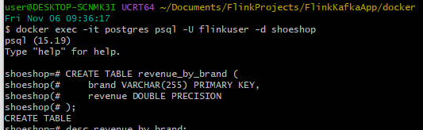

Produce the messages to Kafka topics `shoes` and `shoe_orders` using the provided Java application.

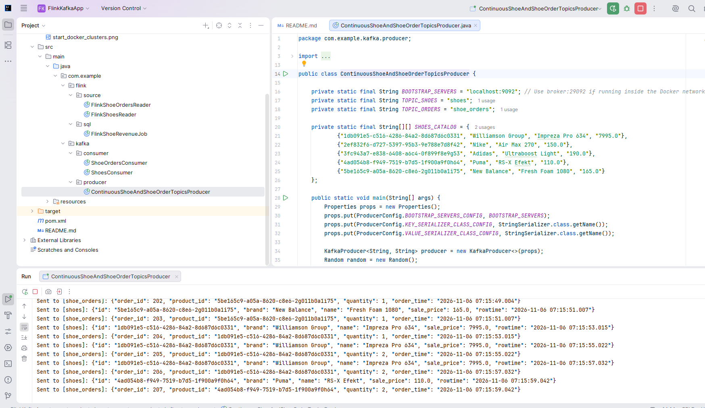

Verify the messages in Kafka topics `shoes` and `shoe_orders` using the provided Java applications.

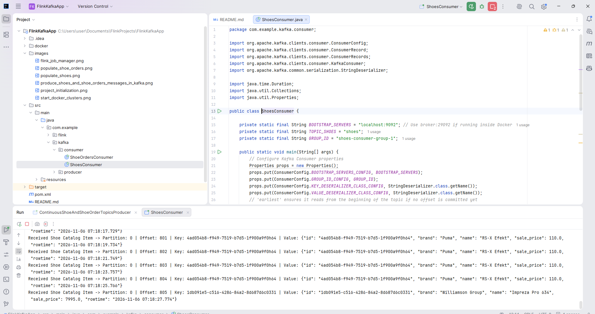

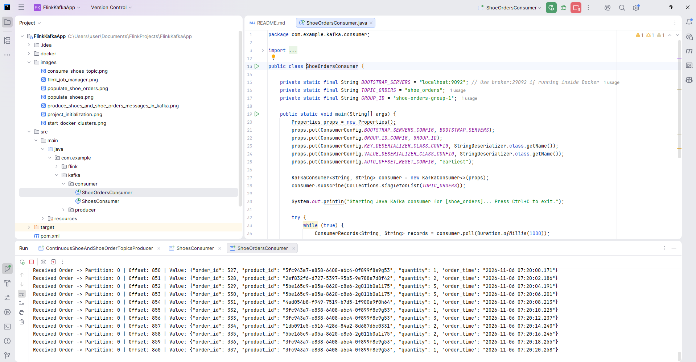

Use the Flink source kafka connector to consume the messages from Kafka topics `shoes` and `shoe_orders` in a Flink application.

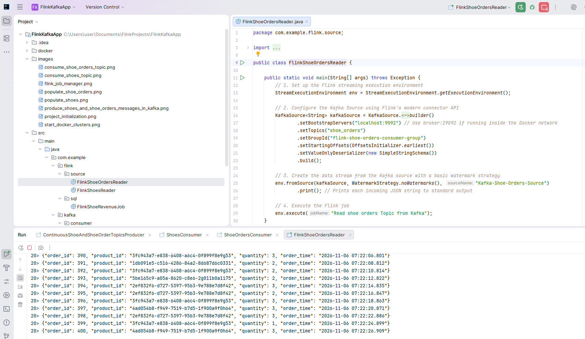

Aggregate the revenue by brand using Flink SQL in a Flink application.

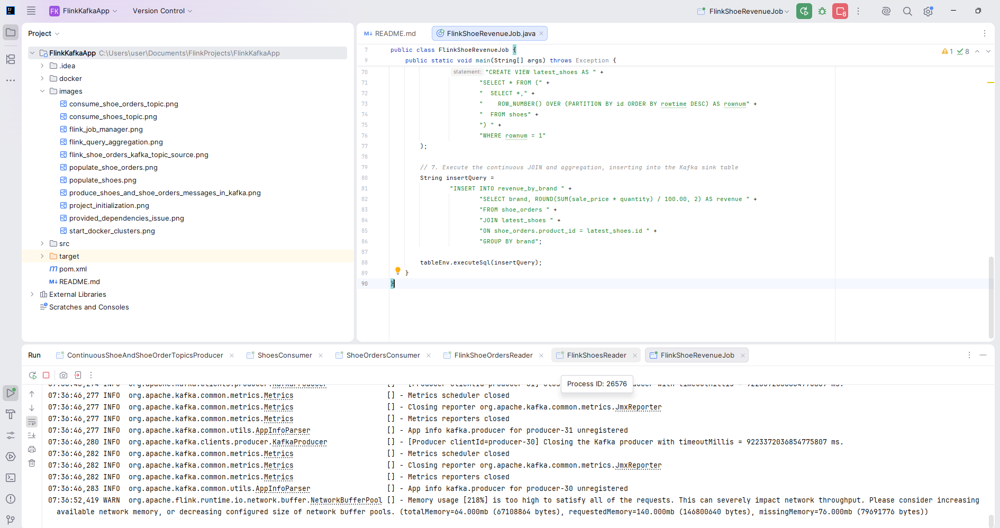

Go to the broker container and observe that the `revenue_by_brand` topic has been created:

```shell
user@DESKTOP-SCNMK3I UCRT64 ~/Documents/FlinkProjects/FlinkKafkaApp/docker
Fri Nov 06 07:38:39
$ docker exec -it broker sh
sh-4.4$ kafka-topics --bootstrap-server localhost:9092 --list
__consumer_offsets
_confluent-command
_confluent-telemetry-metrics
_confluent_balancer_api_state
quickstart
revenue_by_brand           <<<<<<<<<<<
shoe_orders
shoes
sh-4.4$
```

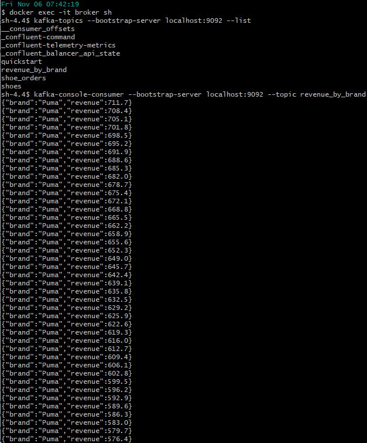

Use the provided Java application to consume the messages from the `revenue_by_brand` topic:

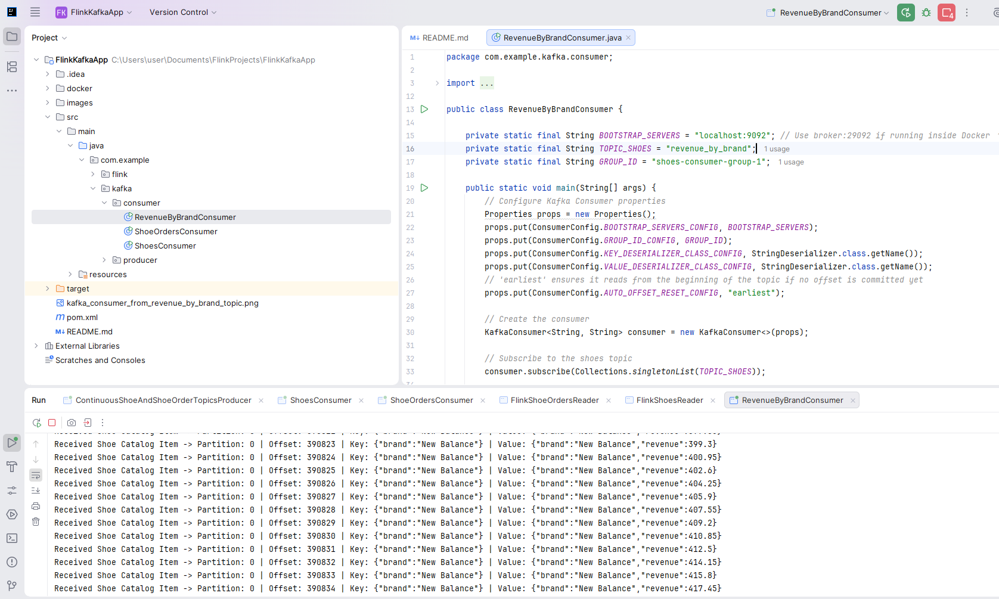

Connect to the postgresql database and verify that the `revenue_by_brand` table has been created and populated with the aggregated revenue by brand:

```shell
shoeshop=# select * from revenue_by_brand limit 10;
      brand       | revenue
------------------+---------
 Vans             |     1.5
 Converse         |     2.6
 Williamson Group | 82828.2
 Adidas           |  1875.3
 Saucony          |     1.7
 Mizuno           |     4.2
 On               |     5.1
 Under Armour     |     1.4
 Puma             |  1130.8
 New Balance      | 1701.15
(10 rows)

```

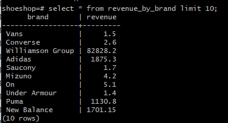

## Known issues

If you find this error just check this option and try again.

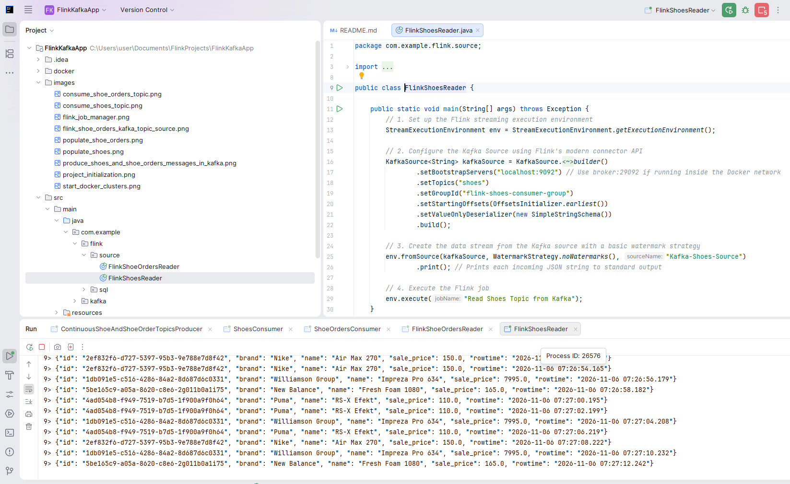